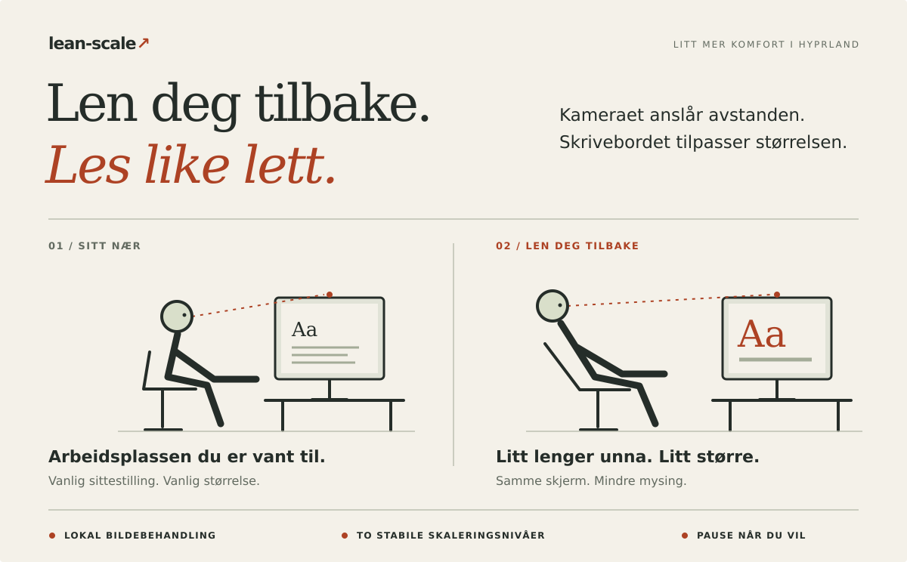

# lean-scale

**Len deg tilbake. Skrivebordet henger med.**



lean-scale bruker webkameraet til å anslå hvor langt unna du sitter, og tilpasser **skjermskaleringen i Hyprland**. Len deg tilbake og les behagelig. Sett deg frem igjen for å få mer arbeidsplass på skjermen.

- **Alt skjer lokalt.** Ingen skytjenester, ingen opptak. Kamerabildene blir på maskinen din.
- **Stabilt, ikke rykkete.** To kalibrerte skaleringsnivåer, utjevning og en kort ventetid før størrelsen endres.
- **Enkelt å angre.** Pause frigjør webkameraet. Pause eller vanlig avslutning gjenoppretter skaleringen du startet med.

## Prøv selv

Du trenger **Linux, et V4L2-webkamera, [uv](https://docs.astral.sh/uv/) og Hyprlands Lua-API** (`hyprctl eval`; testet med Hyprland 0.56). Kjør fra Hyprland-økten din, uten sudo.

Fra prosjektmappen:

```sh
uv sync --locked
./lean-scale setup             # last ned den lille ansiktsmodellen én gang
./lean-scale calibrate         # kalibrer vanlig og tilbakelent sittestilling
./lean-scale run --dry-run     # prøv sporingen uten å endre skjermskaleringen
```

Ser det ut til å fungere? Stopp med **Ctrl+C**, og kjør:

```sh
./lean-scale run
```

## Du har kontrollen

Fra en annen terminal:

```sh
./lean-scale toggle    # sett på pause / fortsett
./lean-scale stop      # stopp og gjenopprett skaleringen du startet med
```

Etter et krasj kan du bruke `./lean-scale restore` til å gjenopprette skaleringen du startet med.

**Eksperimentelt:** Programmet endrer faktisk skjermskalering. Vinduer får derfor ny størrelse og plassering, og overgangene kan flimre. Det anslår avstand, ikke kroppsholdning. Prøv først uten skjermendringer, og vurder deretter om ekte skalering passer måten du jobber på.

[Oppsett, hurtigtaster og tilpasning →](docs/GUIDE.md) · [Ansiktsmodell og lisens →](THIRD_PARTY.md)
