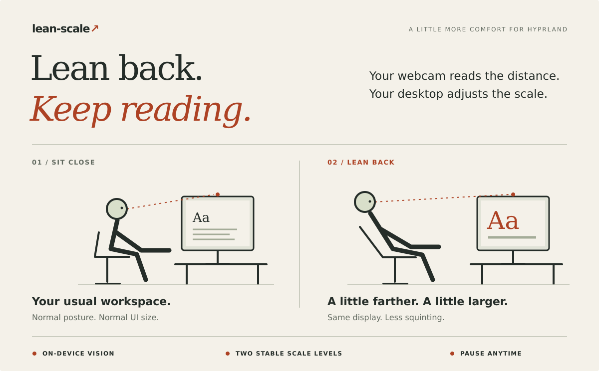

# lean-scale

**Your chair reclines. Your desktop should keep up.**



lean-scale uses your webcam to estimate how far away you are and adjusts your **Hyprland monitor scaling**. Lean back to read comfortably. Sit forward to get your workspace back.

- **Local by design.** No cloud, no recordings. Frames stay on your machine.
- **Steady, not twitchy.** Two calibrated scale levels, smoothing, and a stable-posture delay.
- **Easy to undo.** Pause releases the webcam; pause or a normal exit restores your starting scale.

## Try it

You need **Linux, a V4L2 webcam, [uv](https://docs.astral.sh/uv/), and Hyprland's Lua API** (`hyprctl eval`; tested with Hyprland 0.56). Run inside your Hyprland session, not with sudo.

From the project directory:

```sh
uv sync --locked
./lean-scale setup             # download the small face model once
./lean-scale calibrate         # record your normal and leaned-back positions
./lean-scale run --dry-run     # try tracking without changing your display
```

Happy with the decisions? Stop with **Ctrl+C**, then run:

```sh
./lean-scale run
```

## Stay in control

From a second terminal:

```sh
./lean-scale toggle    # pause / resume
./lean-scale stop      # stop and restore the starting scale
```

After a hard crash, use `./lean-scale restore` to recover your starting scale.

**Experimental:** this changes real monitor scaling, so windows reflow and transitions can flicker. It estimates distance, not body posture. Try the dry run first, then see whether real scaling feels right for your workflow.

[Setup, hotkeys & tuning →](docs/GUIDE.md) · [Face model & license →](THIRD_PARTY.md)
